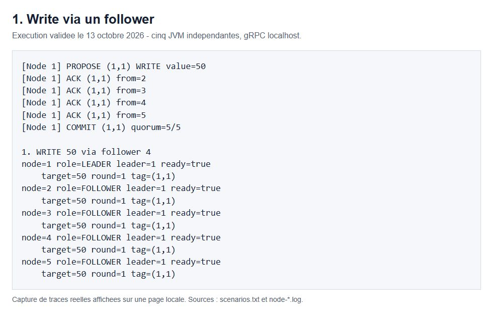
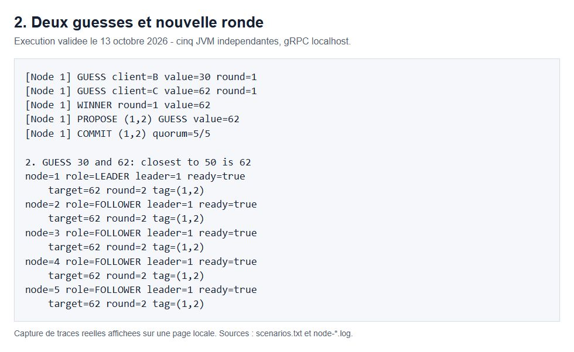
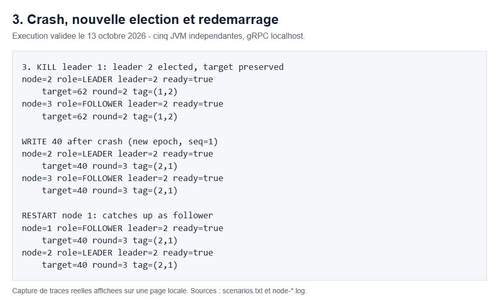
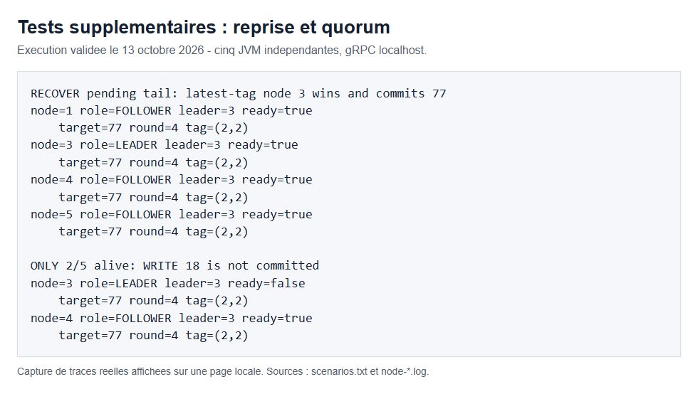

# TP ZooKeeper-like - Yuefan Liu

II.3502 - 13 octobre 2026

## Système ZooKeeper-like

Yuefan Liu - II.3502 Distributed Architecture and Programming - 13 octobre 2026

### Objectif et continuité avec les TP précédents

Le programme utilise cinq serveurs Java indépendants sur localhost. Un leader coordonne les écritures, quatre followers répliquent le journal. Les clients peuvent contacter n'importe quel nœud vivant pour écrire, proposer une guess ou lire la cible.

Je garde la structure du TP gRPC Calculator : définition des messages dans un fichier .proto, ServerBuilder pour démarrer le serveur, ManagedChannel et blocking stub pour appeler un service, puis StreamObserver pour retourner la réponse. Le menu Scanner et les threads ordinaires reprennent le principe du TP Socket. La nouveauté est la coordination entre plusieurs serveurs.

### Organisation du code

| Composant | Responsabilité |
| --- | --- |
| NodeServer / NodeRuntime | Serveur, connexions, composants et threads de fond. |
| GameServiceImpl / ClientApp | Write, Guess, Read ; transfert au leader ; menu client. |
| LeaderCoordinator | PROPOSE, ACK durables, quorum et COMMIT. |
| CoordinationServiceImpl | Réception des messages entre nœuds via gRPC. |
| ElectionManager | Heartbeat, comparaison des tags et synchronisation. |
| GameEngine | Fenêtre de guesses et sélection par distance absolue. |
| NodeState / LogStore | État partagé, journal persistant et reprise. |

### Choix simples

Le quorum est fixé à trois sur cinq. Les appels entre nœuds ont un délai de 300 ms. Le leader envoie des heartbeats avec un intervalle de 500 ms après chaque cycle ; le timeout est de cinq secondes plus un petit décalage par ID. Un verrou sérialise les écritures et les élections locales.

## 1. Écriture normale

Le client A envoie Write(50) au follower 4. Celui-ci transmet la requête au leader sans modifier sa cible. Le leader attribue le tag (1,1), écrit PROPOSED sur disque, puis envoie Propose aux quatre followers. L'ACK est la réponse RPC, envoyée après persistance du proposal.

Le leader compte sa propre copie et les ACK valides. À partir de trois copies durables, il commit localement et diffuse COMMIT. La cible et la ronde changent seulement après le commit. Les cinq réponses Read finissent avec target=50, round=1 et tag=(1,1).

Figure 1. Traces réelles du leader et lectures des cinq nœuds après Write(50).

### Persistance et concurrence

Chaque journal contient epoch, seq, op, value, status, client, request et round. Les écritures sont forcées sur disque avant l'ACK. Un commit ajoute une version COMMITTED du même tag. Un checkpoint SNAPSHOT en une ligne permet la synchronisation sans retirer les commits existants.

NodeState utilise synchronized pour protéger les variables partagées. Deux écritures concurrentes ne peuvent pas obtenir le même seq. Une même requête client/ID peut être rejouée sans produire une seconde transaction ; le menu affiche l'ID mais crée un nouvel ID à chaque commande.

## 2. Jeu de guesses

Avec la cible 50, le client B propose 30 via le nœud 3 et le client C propose 62 via le nœud 5. Le leader collecte pendant trois secondes à partir de la première guess. Une guess acceptée reste en mémoire et ne change pas immédiatement la cible.

La distance de 30 est |30-50|=20, celle de 62 est |62-50|=12. Le leader choisit donc 62 et crée une opération GUESS qui suit le même cycle PROPOSE, ACK, COMMIT. Les lectures indiquent alors target=62, round=2 et tag=(1,2).

Figure 2. Deux guesses collectées, sélection de 62 et cible identique sur les cinq nœuds.

### Règles ajoutées pour terminer une ronde

La consigne ne fixe pas le moment où toutes les guesses sont reçues. La fenêtre de trois secondes rend la démonstration simple. Un client soumet au plus une guess par ronde ; à distance égale, la première arrivée gagne. Le client lit la ronde avant de soumettre et le serveur refuse une ronde obsolète.

REQUEST_ACCEPTED signifie que la guess est en attente ; REQUEST_COMMITTED signifie qu'une transaction a été commise. Write peut changer la cible pour préparer un autre exemple. Un changement de ronde annule les guesses de l'ancienne ronde.

## 3. Crash et reprise

Le test termine de force le processus du leader 1. Les followers détectent l'absence de heartbeat. Ils échangent leur dernier tag, y compris les proposals non commis. Le plus grand (epoch, seq) gagne ; à tag égal, le plus petit ID gagne. Dans cette exécution, le nœud 2 devient leader.

Le nouveau leader rassemble au moins trois journaux compatibles, préserve les commits et synchronise la queue sélectionnée. Les proposals restants sont re-répliqués à quorum avant leur commit. Il persiste un nouvel epoch et remet seq à zéro. Write(40) utilise ensuite (2,1). Le nœud 1 redémarre avec son ancien journal, reste follower et rattrape la cible 40.

Figure 3. Leader 2 après crash, Write(40) dans le nouvel epoch et retour du nœud 1 en follower.

Pendant la reprise, les écritures normales sont refusées. Les guesses seulement en mémoire doivent être soumises de nouveau. Un proposal déjà enregistré peut être terminé pendant la reprise : une réponse REQUEST_UNCERTAIN ne signifie donc pas que l'opération a définitivement échoué.

## Validation et limites

La commande scripts/test.ps1 passe 17 tests sans échec : neuf de stockage, six d'état, un scénario avec cinq JVM et un test du cycle de vie des processus. Les trois flux, le démarrage en double, le conflit de port et la fermeture concurrente sont vérifiés. Après fermeture, le port et le verrou du journal sont libérés. Les traces sont conservées dans docs/evidence.

Figure 4. Reprise du proposal 77, puis impossibilité de commit avec seulement deux nœuds vivants.

Pour vérifier la queue non commise de façon reproductible, le test injecte volontairement un proposal 77 sur deux followers après l'arrêt du leader 2. La cible reste 40 avant la reprise. Le nœud 3 possède le meilleur tag ; il gagne, synchronise à quorum et commit 77. Cette injection contrôlée est distincte du crash normal.

Le test vérifie aussi les retries, le refus de 101, le refus d'une ronde obsolète et le fait que zéro est une cible valide. Avec deux nœuds, Write(18) n'est pas commis immédiatement ; une fois le troisième revenu, la reprise peut terminer ce proposal incertain.

### Périmètre

C'est un modèle simplifié pour cinq membres fixes, un réseau localhost stable et des arrêts/reprises de processus. Il ne réalise pas tous les mécanismes de ZAB ou Raft et ne garantit pas le consensus pour des partitions ou délais arbitraires. Des journaux contradictoires bloquent la reprise. Read est local : un follower en retard peut rendre un ancien commit avant synchronisation.

Les captures montrent une page locale affichant les sorties réelles du test, et non un terminal interactif. La démonstration manuelle se fait avec les commandes du README. Source des exigences : lab_zookeeper.pdf, II.3502, 2026/27 ; structure de communication reprise des TP gRPC-Protobuf et Sockets de Yuefan Liu.
